# Hastalığa Özgü Tabak İçeriği Uygunluk Tespit Sistemi

Tabak fotoğrafındaki yiyecekleri **YOLOv8** ile ayrı ayrı tespit eden, besin değerlerini hesaplayan ve kullanıcının kronik hastalığına göre **klinik kılavuzlara dayalı uygunluk değerlendirmesi** yapan bir sistem.

Örneğin bir bayram sofrası fotoğrafında kavurma, çay ve domates ayrı ayrı çerçevelenir; her biri seçilen hastalık için *uygun / dikkat / uygun değil* olarak işaretlenir ve tabağa genel bir uygunluk skoru verilir.


<p align="center">
  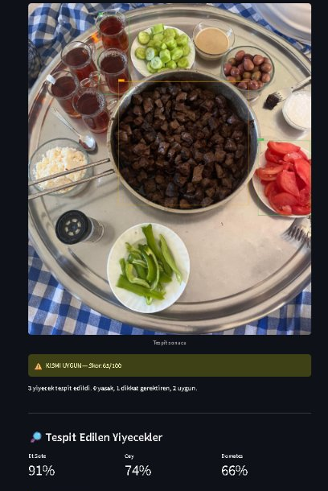
  <br>
  <em>Bayram sofrası analizi: et sote, çay ve domates ayrı ayrı tespit edildi</em>
</p>

---

## Özellikler

- **Çoklu nesne tespiti**: aynı tabaktaki birden fazla yiyeceği ayrı bounding box'larla tespit eder
- **Türk mutfağına odaklı**: sarma, dolma, kavurma, lahmacun, baklava, mercimek çorbası gibi yerel yemekler
- **4 kronik hastalık** için kural tabanlı uygunluk değerlendirmesi
- **Hibrit besin veritabanı**: Türk yemekleri için TürKomp, diğerleri için USDA FoodData Central API
- **Renk kodlu görselleştirme**: kırmızı uygun değil, turuncu dikkat, yeşil uygun
- **Active Learning** destekli etiketleme süreci (Label Studio + ML Backend)

---

## Tespit Örnekleri

| Baklava (Diyabet: Uygun Değil) | Adana Kebap ve Çoban Salatası |
|:---:|:---:|
| 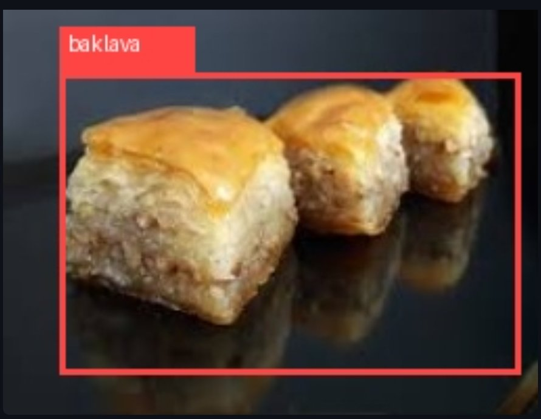 | 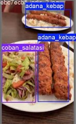 |

---

## Sistem Mimarisi

<p align="center">
  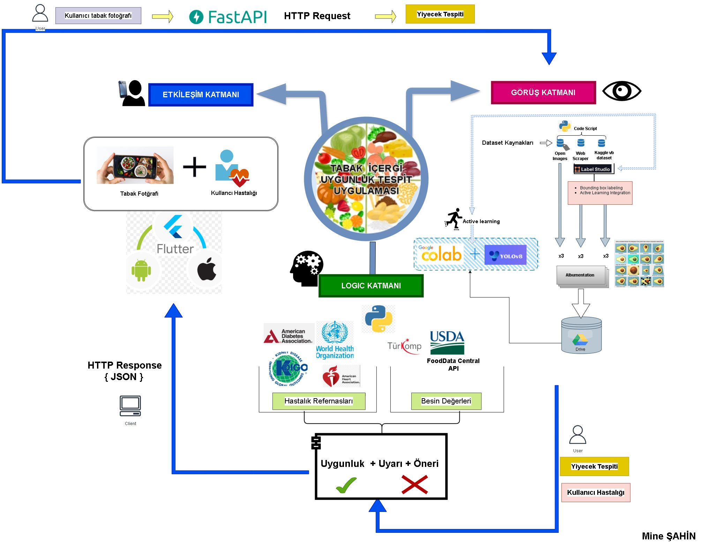
</p>

| Katman | Teknoloji | Görev |
|---|---|---|
| Görüş | YOLOv8s (Ultralytics) | Yiyecek tespiti ve konumlandırma |
| Mantık | FastAPI + Python | Besin sorgulama, kural motoru, skor hesaplama |
| Etkileşim | Streamlit | Fotoğraf yükleme, sonuç görselleştirme |

**İstek akışı:** Kullanıcı fotoğrafı ve hastalığı gönderir → FastAPI görüntüyü YOLOv8'e verir → tespit edilen yiyeceklerin besin değerleri TürKomp/USDA'dan alınır → kural motoru uygunluğu değerlendirir → sonuç JSON olarak arayüze döner.

---

## Hastalık Değerlendirmesi

| Hastalık | Klinik Kaynak | Temel Kriter |
|---|---|---|
| Tip 2 Diyabet | ADA Standards of Care 2024 | Glisemik indeks, şeker içeriği |
| Hipertansiyon | AHA / DASH 2023 | Sodyum, kafein |
| Obezite | WHO Healthy Diet 2023 | Kalori yoğunluğu |
| Kronik Böbrek Hastalığı | KDIGO 2024 | Potasyum, fosfor |

Her tespit edilen yiyecek, seçilen hastalık için **yasak**, **dikkat** veya **uygun** olarak sınıflandırılır.

### Skorlama

| Durum | Sonuç | Skor |
|---|---|---|
| En az bir yasak besin | Uygun Değil | 0 – 40 |
| Yasak yok, dikkat gerektiren var | Kısmi Uygun | 41 – 79 |
| Yasak ve dikkat yok | Uygun | 100 |

Besin değerleri **100 g** referans alınarak gösterilir.

---

## Veri Hazırlama

### Veri toplama

Open Images V7 görüntüleri FiftyOne kütüphanesiyle indirilip YOLO formatına dönüştürülmüştür. Türk mutfağına özgü kategoriler Kaggle Turkish Food Dataset'ten seçilmiştir.

<p align="center">
  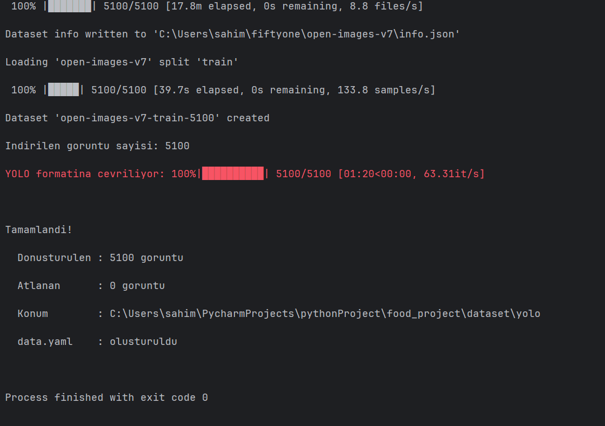
</p>

### Etiketleme: Label Studio + Active Learning

Kaggle görüntüleri Label Studio'da etiketlenmiştir. İlk etiketlenen küçük veri setiyle bir mini model eğitilmiş, bu model ML Backend olarak Label Studio'ya bağlanarak yeni görüntüler için otomatik bounding box önerisi üretmiştir. Etiketleyici yalnızca önerileri onaylamış veya düzeltmiştir.

<p align="center">
  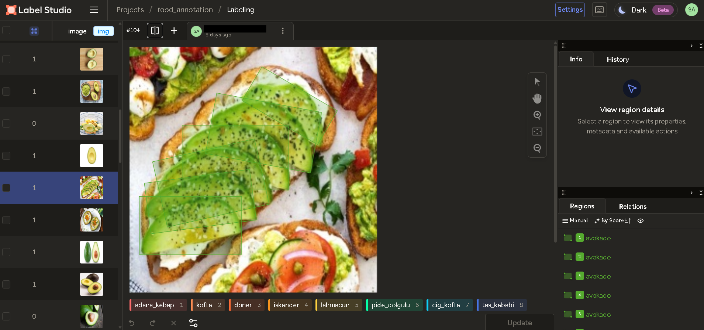
  <br><br>
  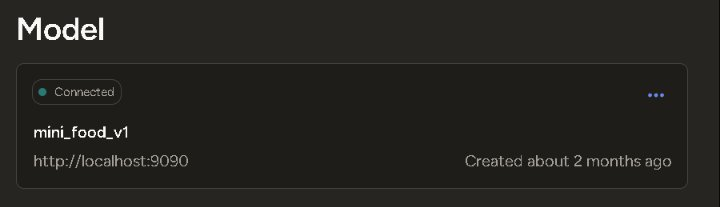
</p>

### Augmentation ve BBox doğrulaması

Albumentations kütüphanesiyle yatay çevirme, döndürme, parlaklık/kontrast, bulanıklık ve gürültü dönüşümleri uygulanmıştır. Dönüşüm sonrası bounding box koordinatlarının doğruluğu görsel olarak kontrol edilmiştir.

<p align="center">
  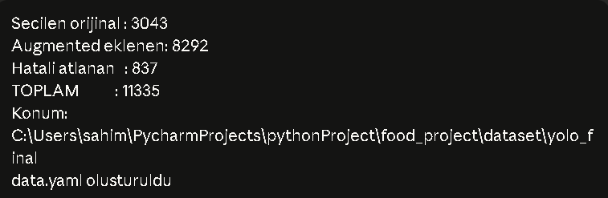
</p>

| | |
|:---:|:---:|
| 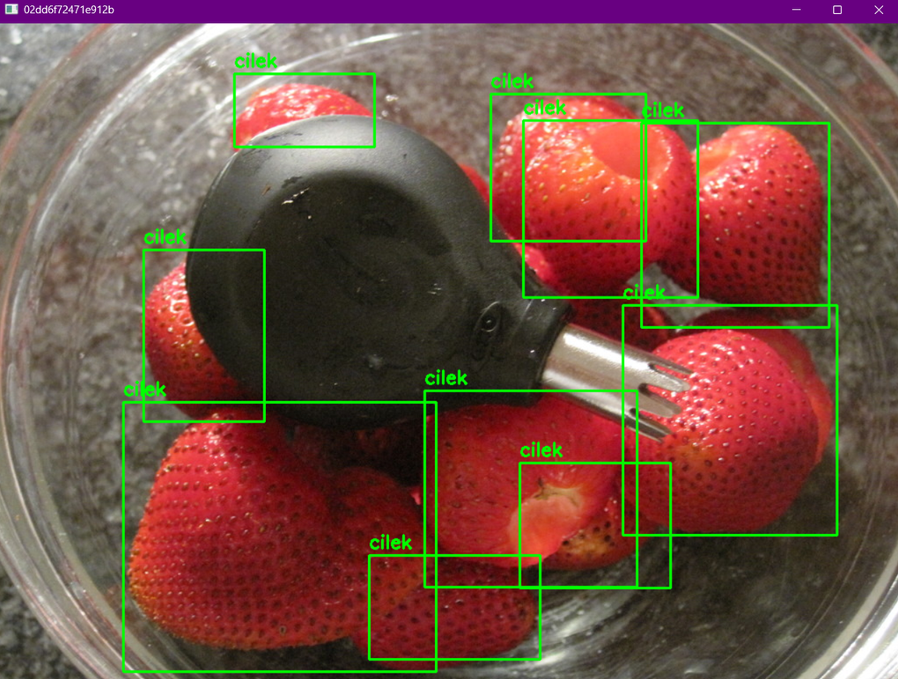 | 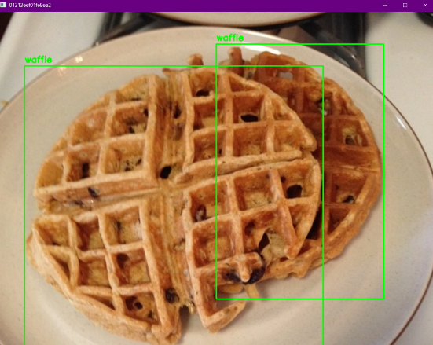 |
| 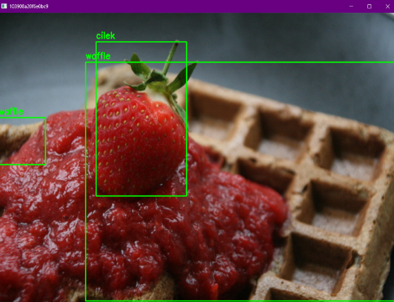 | 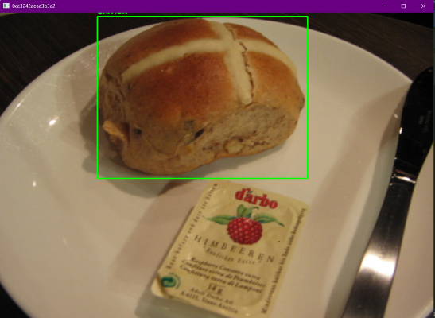 |

### İşlem hattı

```
Label Studio etiketleme (Active Learning)
        ↓
merge_datasets.py   → kaynakları birleştirme, class ID eşleştirme
        ↓
split_dataset.py    → %80 train / %20 validation
        ↓
augment_mini.py     → yalnızca train kümesine dengeli augmentation
                      (kategori başına ~150 görüntü hedefi)
        ↓
YOLOv8s eğitimi (Google Colab)
```

Augmentation **split işleminden sonra ve yalnızca train kümesine** uygulanır; böylece veri sızması (data leakage) önlenir ve validation kümesi gerçek performansı yansıtır.

---

## Model Performansı

| Parametre | Değer |
|---|---|
| Mimari | YOLOv8s (COCO ön-eğitimli, transfer learning) |
| Görüntü boyutu | 640 × 640 |
| Eğitim | 43 epoch (early stopping, en iyi epoch: 28) |
| Donanım | Google Colab, Tesla T4 |
| **mAP@0.5** | **0.782** |
| **mAP@0.5:0.95** | **0.624** |
| Precision / Recall | 0.857 / 0.735 |

**Öne çıkan kategoriler (mAP@0.5):** baklava 0.995, zeytin 0.995, menemen 0.995, mercimek çorbası 0.995, karnıyarık 0.995, kısır 0.995, çay 0.964, dolma 0.956, ayran 0.938, sarma 0.875

| Eğitim kaybı (box_loss) | Doğrulama mAP@0.5 |
|:---:|:---:|
| 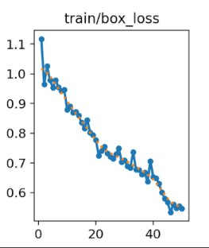 | 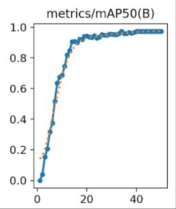 |

---

## Proje Yapısı

```
food_project/
├── backend/
│   ├── main.py              # FastAPI uç noktaları
│   ├── model.py             # YOLOv8 tespit fonksiyonu
│   ├── nutrition.py         # TürKomp + USDA besin sorgulama
│   ├── rules.py             # Hastalık kural motoru ve skorlama
│   └── turkomp_db.json      # Yerel Türk yemekleri besin veritabanı
├── docs/images/             # README görselleri
├── app.py                   # Streamlit demo arayüzü
├── ml_backend.py            # Label Studio ML Backend (Active Learning)
├── merge_datasets.py        # Veri kaynaklarını birleştirme
├── split_dataset.py         # Train / validation ayrımı
├── augment_mini.py          # Dengeli augmentation
├── convert_to_yolo.py       # Open Images → YOLO format dönüşümü
├── select_kaggle.py         # Kaggle veri setinden kategori seçimi
├── final_data.yaml          # Final model sınıf listesi
└── mini_data.yaml           # Mini model sınıf listesi
```

---

## Kurulum ve Çalıştırma

### 1. Bağımlılıklar

```bash
pip install ultralytics fastapi uvicorn python-multipart requests streamlit pillow
```

### 2. Model dosyası

Eğitilmiş model ağırlıkları (`best.pt`, ~22 MB) boyutu nedeniyle repoda yer almaz. Dosyayı `backend/` klasörüne yerleştirin.

### 3. USDA API anahtarı

[fdc.nal.usda.gov/api-key-signup](https://fdc.nal.usda.gov/api-key-signup.html) adresinden ücretsiz anahtar alıp `backend/nutrition.py` içindeki `USDA_API_KEY` değişkenine yazın.

### 4. Backend'i başlatma

```bash
cd backend
python main.py
```

API dokümantasyonu: `http://localhost:8000/docs`

### 5. Arayüzü başlatma

Yeni bir terminalde:

```bash
python -m streamlit run app.py --server.address 0.0.0.0
```

Arayüz: `http://localhost:8501`
Aynı ağdaki telefondan erişim: `http://<bilgisayar-IP>:8501` (IP için `ipconfig`)

---

## API Kullanımı

<p align="center">
  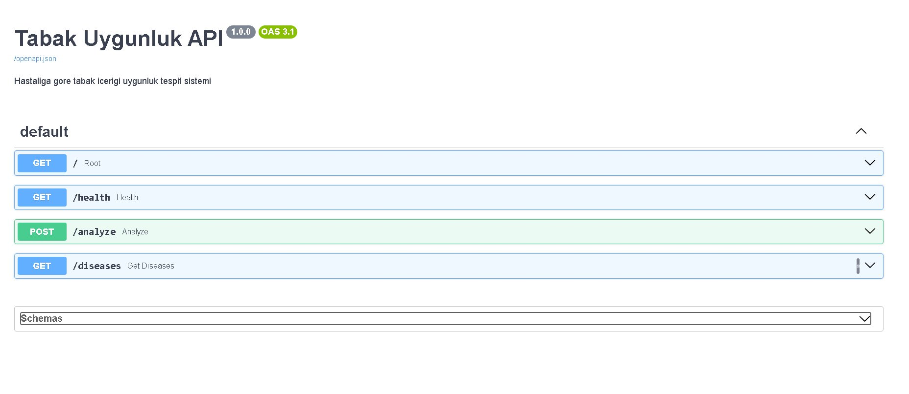
</p>

**`POST /analyze`**: `image` (dosya) + `disease` (`diyabet` | `hipertansiyon` | `obezite` | `bobrek`)

```json
{
  "basarili": true,
  "tespit": [
    { "label": "avokado", "confidence": 0.909,
      "bbox": { "x": 42.7, "y": 21.2, "width": 46.3, "height": 54.2 } }
  ],
  "besin_degerleri": {
    "avokado": { "kalori": 167, "potasyum": 507, "kaynak": "usda" }
  },
  "uygunluk": {
    "hastalik": "Kronik Böbrek Hastalığı",
    "sonuc": "UYGUN DEGİL",
    "skor": 30,
    "ozet": "1 yiyecek tespit edildi. 1 yasak, 0 dikkat gerektiren, 0 uygun."
  }
}
```

Diğer uç noktalar: `GET /health`, `GET /diseases`

---

## Veri Setleri ve Kaynaklar

| Kaynak | Bağlantı |
|---|---|
| Kaggle Turkish Food Dataset | https://www.kaggle.com/datasets/dietapp/turkish-food |
| Open Images V7 | https://storage.googleapis.com/openimages/web/index.html |
| TürKomp Ulusal Gıda Kompozisyon Veritabanı | https://turkomp.tarimorman.gov.tr/ |
| USDA FoodData Central | https://fdc.nal.usda.gov/ |
| Label Studio | https://github.com/HumanSignal/label-studio |
| Ultralytics YOLOv8 | https://github.com/ultralytics/ultralytics |

---

## Sınırlılıklar

- **Porsiyon miktarı ölçülmez**: değerlendirme besin türüne göre yapılır, miktara göre değil.
- **Pişirme yöntemi ayırt edilmez**: örneğin haşlanmış ve kızartılmış patates aynı değerlendirilir.
- **Hastalık evresi dikkate alınmaz**: özellikle böbrek hastalığında kısıtlamalar evreye göre değişir.
- Bazı kategorilerde etiketli veri sayısı sınırlı olduğundan tespit güveni düşük olabilir.

Bu sistem bir **karar destek aracıdır**; tıbbi beslenme tedavisi yerine geçmez. Kişisel beslenme planı için bir diyetisyene veya hekime danışılmalıdır.

---

## Gelecek Çalışmalar

- Flutter ile mobil uygulama
- Porsiyon tahmini (derinlik / referans nesne ile)
- Kategori sayısının ve etiketli verinin artırılması
- Kullanıcı profili ve analiz geçmişi
- Bulut üzerinde yayınlama

---

## Geliştirici

**Mine Şahin**, Pamukkale Üniversitesi, Bilgisayar Mühendisliği
Danışman: Dr. Öğr. Üyesi Alperen Eroğlu
Bilgisayar Mühendisliği Uygulama Tasarımı Dersi, 2025–2026
